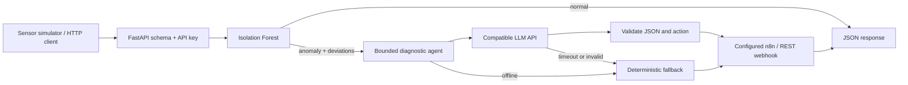

# HOPn | Intelligent anomaly detection & diagnostic agent

**Candidate:** Duggireddy Sasindhar Reddy · sasindhar9542@gmail.com  
24-hour evaluation proof of concept: Python / FastAPI, scikit-learn Isolation Forest,
an OpenAI-compatible LLM adapter (including Gemini), and an anomaly webhook.

## Live demo

- [Service home](https://hopn-anomaly.vercel.app/)
- [Interactive API documentation](https://hopn-anomaly.vercel.app/docs)
- [Health endpoint](https://hopn-anomaly.vercel.app/healthz)
- [GitHub repository](https://github.com/SASINDHAR/Intelligent-AI-Agent-Automated-Anomaly-Detection-Microservice)

The public Vercel demo runs in **live Gemini diagnostics mode** with external webhook
delivery disabled. The provider key is stored as a Vercel secret. Use `/docs` to submit the example
telemetry. Production HTTP checks passed for health, Swagger, normal telemetry,
anomalous telemetry and invalid input (422); responses are recorded in
`docs/live-verification.json`. GitHub Actions also passed the Python tests, Docker
build and container health check. A credentialed Gemini request returned
`source: "llm"`, a structured diagnosis and no fallback; see
`docs/gemini-verification.json`. Local runs still default to offline mode.
Cloud Run deployment was attempted but
blocked by disabled Google Cloud billing; Vercel is the active deployment.

## Quick start

Use Python 3.12+. Run all commands from this folder.

```sh
python -m venv .venv
# Linux/macOS:
source .venv/bin/activate
# Windows PowerShell instead: .venv\Scripts\Activate.ps1
pip install -r requirements-dev.txt
python -m pytest -q
python -m uvicorn app.main:app --host 127.0.0.1 --port 8080
```

Default offline mode needs no secrets or network. The model trains once at startup
on 2,000 reproducible synthetic healthy observations. Offline diagnosis is an
explicitly labelled deterministic rule-based fallback, not an LLM inference.

Open [Swagger UI](http://localhost:8080/docs) or [health](http://localhost:8080/healthz).
In another terminal:

```sh
curl -X POST http://localhost:8080/v1/telemetry -H "Content-Type: application/json" --data-binary @examples/normal.json
curl -X POST http://localhost:8080/v1/telemetry -H "Content-Type: application/json" --data-binary @examples/anomaly.json
python scripts/simulate.py
```

On Windows use `curl.exe` if `curl` is a PowerShell alias. The simulator sends eight
normal and four anomalous observations. Normal responses have `diagnosis: null`;
anomalies have a structured diagnosis and workflow delivery status.

## Containers

```sh
cp .env.example .env
# PowerShell: Copy-Item .env.example .env
docker compose up --build
# Or without Compose:
docker build -t hopn-evaluation .
docker run --rm -p 127.0.0.1:8080:8080 --env-file .env hopn-evaluation
```

The slim Python image runs as UID 10001, excludes tests/docs/secrets and honors
`PORT`. No database, downloaded model or GPU is needed. `.env` is used by Docker;
the Python app does not automatically load dotenv files. For a native run export
environment variables in your shell (PowerShell: `$env:LLM_MODE = "live"`).

## Configuration and live LLM

| Variable | Default | Purpose |
|---|---|---|
| `LLM_MODE` | `offline` | `live` enables the external provider |
| `LLM_API_KEY` | empty | Required for live mode |
| `LLM_MODEL` | empty | Required in live mode; choose a model available to your account |
| `LLM_BASE_URL` | Gemini OpenAI-compatible HTTPS URL | Base ending in `/openai/` or `/v1/` |
| `INGEST_API_KEY` | empty | Optional `X-API-Key` on ingestion; set for exposure outside localhost |
| `WORKFLOW_WEBHOOK_URL` | empty | Anomaly POST target; empty disables delivery |
| `WORKFLOW_TOKEN` | empty | Optional outgoing bearer token |
| `PORT` | 8080 in Docker | Container listening port |

To use Gemini, set `LLM_MODE=live`, your `LLM_API_KEY` and an available `LLM_MODEL`.
The configured default base is `https://generativelanguage.googleapis.com/v1beta/openai/`.
Other providers must implement Chat Completions and JSON Schema response output. The
provider response is validated locally; unsupported response modes or unavailable
models produce a labelled fallback. Vertex IAM/OAuth is not implemented by this
API-key adapter. Never commit `.env`.

The agent is a bounded single-step diagnostic workflow: observe -> score -> build
evidence -> request schema-constrained diagnosis -> validate -> notify. Gemini
receives a strict JSON Schema plus a prompt that forbids extra properties; Pydantic
revalidates every response and the action allowlist. It does not claim autonomous planning
or arbitrary function calling. The application owns the notification tool and its
fixed configured destination; the LLM cannot choose a URL or execute commands.

## Automated workflow integration

Set `WORKFLOW_WEBHOOK_URL` to an n8n production Webhook URL or any REST receiver.
For n8n, create a workflow with a **POST Webhook** node, configure **Respond
Immediately**, and activate/publish the workflow. Optionally configure header
authentication to match `Authorization: Bearer <WORKFLOW_TOKEN>`. Then add an IF
node on `body.event.diagnosis.recommended_action` and route to your maintenance
review process. Use HTTPS outside local development. Inside Docker, `localhost`
is the API container; on Docker Desktop use `host.docker.internal` for a host receiver.

Only anomalies trigger a POST. The payload is:

```json
{"event_type":"anomaly.detected","event":{"event_id":"UUID","telemetry":{},"detection":{},"diagnosis":{}}}
```

The nested objects contain the same fields as the API response (see
`docs/example-response.json`). `Idempotency-Key` equals the event UUID. The receiver
should deduplicate by this key. HTTP 2xx means delivery was accepted, not that any
downstream action completed. There is one delivery attempt, no durable queue or
retry: failures return `workflow_status: "failed"`. Client resubmissions create new
events; ingestion does not provide deduplication. No messages or machine commands
are sent by default.

## Architecture and API specification



Full contracts, policy and error semantics: [API & design](docs/architecture.md).
An exported [OpenAPI schema](docs/openapi.json) is included; `/openapi.json` is the
runtime authority. The actual system prompt is `SYSTEM_PROMPT` in `app/main.py`.

## Testing and evaluation

`python -m pytest -q` covers healthy/anomalous inputs, malformed/missing/out-of-range
data, authentication, startup config, repeatable model behavior, mock live LLM
success, timeouts, 429/503, invalid JSON, disallowed actions and webhook failures.
Tests mock external APIs and never need credentials. Measured local results and
synthetic model metrics are in [validation](docs/validation.json).

Local result: **33 tests passed** (one upstream Starlette TestClient deprecation
warning). A real localhost HTTP smoke test also passed: Uvicorn accepted telemetry
and delivered exactly one anomaly to a temporary REST receiver. Reproduce it with
`python -m scripts.smoke_http`; evidence is in `docs/http-smoke.json`. Run
`python -m scripts.validate` to regenerate the test log, synthetic metrics, OpenAPI
schema and example response. These scripts run offline except for localhost HTTP.

The baseline assumes a steady-state motor: temperature 65 +/- 5 C, vibration
2 +/- 0.35 mm/s, current 10 +/- 1 A (mean +/- standard deviation). Isolation Forest
flags unusual combinations without labelled fault training. Negative decision
margin means anomaly; its magnitude is not a probability. Training contamination
is 2%; this is a calibration assumption, not field accuracy. Deviation values
are descriptive z-scores, not causal explanations or SHAP attributions. This model
does not detect temporal trends, adapt per asset, or distinguish startup/shutdown
from faults. All root causes are inspection hypotheses.

## Reliability and deployment

Model inference runs in a thread pool; asynchronous HTTP reuses connections.
LLM and webhook calls have total budgets of 10s and 3s respectively, plus model
inference/queueing overhead. No retries amplify a provider outage. Invalid live
configuration fails startup; provider failure preserves detection with a fallback.
No persistent event storage is claimed. Logs contain event IDs and outcomes, not
API keys or sensor payloads. Configure logging at deployment for INFO events.
Public deployment needs rate limits/body limits at a gateway and an authentication
policy. Retain Cloud Run IAM authentication; inject secrets with Secret Manager.

Example after configuring Google Cloud CLI, billing, permissions and a project:

```sh
gcloud run deploy hopn-anomaly --source . --region europe-west1 --no-allow-unauthenticated --set-env-vars LLM_MODE=offline
```

This command is provided, not executed. The service listens on `0.0.0.0:$PORT`.
For live mode set model/base URL and inject the API key as a secret. Start with
low concurrency, measure p95, then scale. Each process builds its own small model
at startup. For production, version a pre-trained artifact, add Pub/Sub or a
transactional outbox, persistent idempotency, per-asset calibration, drift checks,
and monitoring. An in-process background task is deliberately not used for delivery
because serverless instances may stop after a request.

## Submission contents

Source, examples, Dockerfile, Compose config, tests, CI, API specification,
validation evidence and `docs/technical-summary.pdf` (exactly two pages).
The report covers rationale, limitations and a six-month contribution roadmap.
`docs/submission-email.txt` is an editable reply draft. Review the project and run
the demo before submitting; live provider, Docker and cloud execution limitations
are explicitly recorded in validation evidence.

## Primary references

- [Gemini OpenAI compatibility](https://ai.google.dev/gemini-api/docs/openai)
- [Cloud Run container contract](https://docs.cloud.google.com/run/docs/container-contract)
- [Isolation Forest API](https://scikit-learn.org/stable/modules/generated/sklearn.ensemble.IsolationForest.html)
